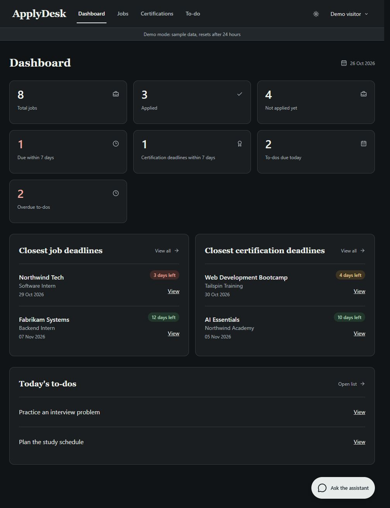
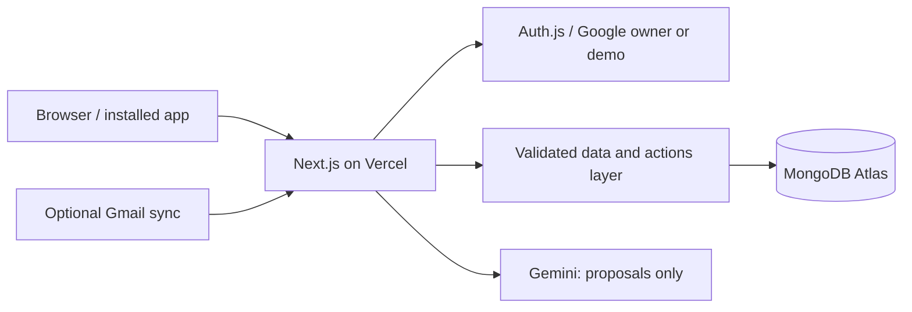

<div align="center">

# ApplyDesk

**Jobs, certifications and to-dos. One workspace, with an AI assistant.**

[Open app](https://apply-desk-six.vercel.app) · [Try the demo](https://apply-desk-six.vercel.app/demo) · [Deployment guide](docs/DEPLOY.md) · [Design preview](.codex/design-references/applydesk-dark.html)

</div>



ApplyDesk is a full-stack personal application tracker. Save opportunities, track learning progress,
and organize the work around them. One verified Google account owns the workspace; visitors get isolated demos.

## Features

| Area | Capabilities |
| --- | --- |
| Jobs | Manual CRUD, deadlines, compensation, notes, priorities and inline application status |
| Certifications | Registration/exam dates, prerequisites, progress, credentials and completion tracking |
| To-do | Quick add, inline edits, tags, priorities, linked records and date-based sections |
| Dashboard | Summaries, closest deadlines and today's tasks, loaded on the server |
| Assistant | Text, screenshot, voice and public URL inputs; reviewable proposals, batch apply and undo |
| Interface | Responsive layout, light/charcoal themes, saved preference and a floating chat panel |
| Gmail | Optional owner-only, read-only suggestions with an explicit accept/dismiss step |

## Try it without an account

Open [the public demo](https://apply-desk-six.vercel.app/demo) and choose **Enter the demo**.
Each visitor receives fictional records in a separate tenant. Documents expire after 24 hours;
MongoDB TTL cleanup is asynchronous. Other Google accounts cannot sign in as owners.
Demo AI allows at most two calls per session and shares a global daily budget. Manual tracking stays available.

## Architecture



Frontend and backend deploy together from this repository. Server Components read the data layer directly.
TanStack Query handles optimistic edits with rollback and no single-item list refetch. All record access
is scoped to the signed-in user; AI writes pass the same strict validators as manual forms.
During navigation, the current screen stays visible until its destination is ready.

## Run locally

Requires **Node.js 20.9+**, npm, MongoDB Atlas, a Google OAuth Web client and a Gemini API key.

```bash
git clone https://github.com/SayemHasan74/ApplyDesk.git
cd ApplyDesk
npm ci
```

Copy `.env.example` to `.env.local` and fill every variable below. Create the `applydesk` database
and give its application user `readWrite` on that database. Register local OAuth callbacks:
`http://localhost:3000/api/auth/callback/google` and `http://localhost:3000/api/gmail/callback`.
Run `npm run db:indexes` once, then `npm run dev`. Open `http://localhost:3000`.

## Environment

Keep values server-side. `.env*` files are ignored except the empty `.env.example` template.

| Variable | Purpose | Source |
| --- | --- | --- |
| `MONGODB_URI` | Atlas connection ending in `/applydesk` | Atlas → Connect → Drivers |
| `AUTH_SECRET` | Stable session secret, at least 32 characters | `npx auth secret` |
| `AUTH_GOOGLE_ID` | OAuth Web client ID | Google Cloud → Auth Platform → Clients |
| `AUTH_GOOGLE_SECRET` | Secret for the same OAuth client | Google Cloud client creation |
| `ALLOWED_EMAIL` | Single owner's verified Google email | Your Google account |
| `APP_URL` | App origin, without a trailing slash | Localhost or production HTTPS URL |
| `GEMINI_API_KEY` | Server-side AI access | Google AI Studio → API keys |
| `GEMINI_MODEL` | Primary available model ID | Account's Gemini model availability |
| `GEMINI_FALLBACK_MODELS` | Comma-separated available fallback IDs | Same model catalog |
| `ENCRYPTION_KEY` | Stable 32-byte base64 Gmail token encryption key | `openssl rand -base64 32` |
| `CRON_SECRET` | Separate secret for scheduled sync | Separate `openssl rand -base64 32` value |
| `DEMO_AI_DAILY_LIMIT` | Global daily demo AI budget | Positive integer, e.g. `6` |

## How the AI works

1. Send text, one screenshot, voice, or a public page URL in the assistant.
2. Images are compressed locally; voice becomes 16 kHz mono WAV. Media is not persisted.
3. Gemini answers from your records or returns structured proposals; it never executes database writes.
4. Review fields, edit supported create cards, deselect bulk items, or discard the proposal.
5. Confirm submits one batch; the server revalidates inputs, permissions and tenant ownership.
6. Successful changes receive before/after audit snapshots; Undo restores them in reverse order.
7. Daily budgets, timeouts and Stop controls bound requests; mutations do not auto-retry.
8. Optional Gmail classification creates suggestions with a separate five-call daily AI budget.

## Commands and verification

| Command | Purpose |
| --- | --- |
| `npm run dev` / `npm run build` / `npm start` | Develop, build and serve |
| `npm run lint` / `npm run typecheck` | ESLint and strict TypeScript checks |
| `npm test` | Vitest logic, validation, permission and security audits |
| `npm run db:indexes` | Create tenant, unique and TTL indexes |
| `node scripts/audit-bundles.mjs` | Audit production initial JavaScript after building |

Run lint, typecheck, test and build before pushing. Verify navigation, CRUD and AI Confirm/Undo in a configured browser.

## Deployment and optional integrations

Import this repo into Vercel as **Next.js**; MongoDB remains on Atlas. Functions run in Singapore (`sin1`).
Follow [docs/DEPLOY.md](docs/DEPLOY.md) for variables, indexes and production OAuth callbacks.
Chrome/Edge can install the app in a standalone window; there is no service worker or offline mode.
Gmail requires enabling its API, connecting in Settings and completing Google's consent setup.
Publish OAuth **In production** to avoid testing-mode Gmail refresh tokens expiring after seven days.
Set GitHub Actions secrets **`APP_URL`** and **`CRON_SECRET`** to match Vercel for the six-hour Gmail workflow.
Gmail production publishing and scheduled sync remain deployment steps, not enabled by cloning the repo.

The [editable HTML design reference](.codex/design-references/applydesk-dark.html) uses existing demo content,
has no database/AI connection, and opens directly in a browser. README screenshots contain demo records only.
